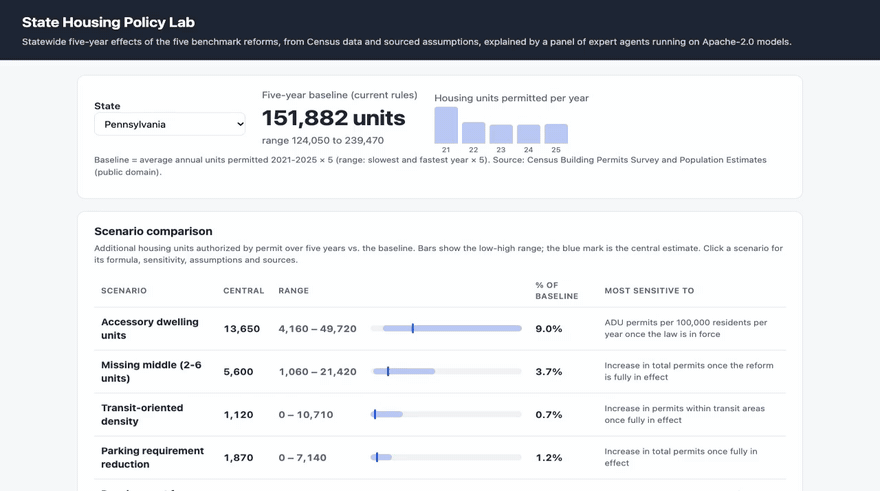

# Housing Turnout Challenge

Team repository for the [Housing Data and Technology Innovation Challenge](https://housingchallenge.turnout.rocks/handbook.html): open-source tools estimating how state housing policy reforms change housing production against a five-year baseline.

## Demo

[Watch the full recording (MP4, 2 min 25 s)](docs/demo/housing-web-demo.mp4). It shows the local web UI (`housing-web`) running with live Apache-2.0 models on OpenRouter (gpt-oss-120b leads, gpt-oss-20b experts):

1. Pennsylvania's five-year baseline, with permits, construction starts and completions by year, and a plain-language explanation of how it is built and back-tested.
2. Data-source links opening the publishers' pages: Census Building Permits Survey, Census Survey of Construction, FHFA House Price Index.
3. "What if the economy is worse?": higher interest rates and lower migration shrink the baseline.
4. A reform's detail view: the result in plain words, what moves it most, and each assumption with its basis and linked sources. A citation opens the study itself.
5. A question to the expert panel. The answer names the experts consulted, links every cited study, and passes the automatic citation check.

The wait for the models is sped up 8×; the on-screen timer shows real time. To run it yourself: `cargo run --release --features llm --manifest-path agents/Cargo.toml --bin housing-web` (offline models without `--features llm`), then open http://127.0.0.1:8787.

## Contents

- [`AGENTS.md`](AGENTS.md): contribution rules (SBOM, data provenance, AI disclosure, licensing). Read it first.
- [`prototypes/`](prototypes/): UI and engine prototypes
- [`research/`](research/README.md): literature index and data-source provenance
- [`ontology/`](ontology/README.md): evidence ontology (77 studies, 41 datasets with license status)
- [`MODEL.md`](MODEL.md): **the scenario model**: statewide five-year effects of the five benchmark reforms for any state, with ranges, sensitivity and sources (`housing-model --state XX`)
- [`agents/`](agents/README.md): condesate expert panel (`housing-ask`) and MCP server (`housing-mcp`, registered in `.mcp.json`)
- [`.claude/skills/`](.claude/skills/): one evidence skill per policy domain
- [`AI_DISCLOSURE.md`](AI_DISCLOSURE.md): AI tool use log

## Continuous integration

| Workflow | Runs | What it checks |
| --- | --- | --- |
| `rust.yml` | every push and PR | `cargo fmt`, `clippy -D warnings` (with and without `llm`), tests (both feature sets), offline panel evals (100% required), that the committed baseline model matches a fresh fit (`housing-fit --check`), the pipeline's unit tests, and that the fetch scripts reproduce every committed table in `data/derived/` |
| `web.yml` | every push and PR | React prototype: frozen-lockfile install, unit tests, typecheck + production build |
| `llm-evals.yml` | on demand, weekly, PRs labelled `llm-evals` | Live-model panel evals on OpenRouter; needs the `OPENROUTER_API_KEY` repository secret |
| `codeql.yml` | every push, PR, weekly | Security analysis for Rust, TypeScript, and the workflows themselves (eligibility gate) |
| `dependabot.yml` | weekly | Cargo, npm, and GitHub Actions updates (eligibility gate) |

One-time repository settings: add the `OPENROUTER_API_KEY` secret, create an `llm-evals` label, and turn on secret scanning and push protection (Settings > Code security). Secret scanning is also an eligibility gate, and it can only be enabled in settings.

## License

Licensed under the [Apache License, Version 2.0](LICENSE). Third-party dependencies keep their own licenses, recorded in each project's SBOM. Datasets are not covered by the code license (Official Rules §7.b.iii); see each provenance file in [`research/data/`](research/data/).
